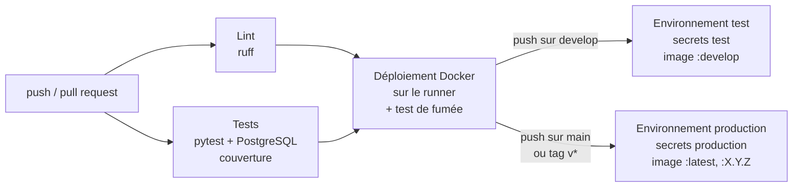

# Pipeline CI/CD et déploiement

## Vue d'ensemble

Fichiers : [`.github/workflows/ci-cd.yml`](../.github/workflows/ci-cd.yml) (pipeline) et
[`.github/workflows/deploy.yml`](../.github/workflows/deploy.yml) (déploiement réutilisé par les deux environnements).



| Job | Quand | Ce qu'il fait | Durée indicative |
|---|---|---|---|
| `lint` | chaque push, chaque PR | `ruff check` (standards de `ruff.toml`) | < 1 min |
| `tests` | chaque push, chaque PR | 160 tests sur un PostgreSQL 17 éphémère, rapport de couverture (seuil 90 %) en artefact et dans le résumé du run | 1–2 min |
| `docker` | si lint et tests passent | construit l'image, lance la pile complète (`docker compose`), exécute `scripts/smoke_test.sh` | 2–3 min |
| `deploy-test` | push sur `develop` (fusion d'une PR) | redéploie avec les secrets de l'environnement **test**, teste, publie l'image `ghcr.io/lefyamghar-ai/p5_ml_deployment:develop` | 2–3 min |
| `deploy-production` | push sur `main` ou tag `v*` | idem avec les secrets **production**, publie `:latest` et `:X.Y.Z` | 2–3 min |

Le pipeline complet reste sous les 10 minutes. Un nouveau push sur la même branche annule le run en cours (`concurrency`).

## Environnements

| Environnement | Où | Base de données | Secrets |
|---|---|---|---|
| **dev** | poste du développeur | PostgreSQL local ou conteneur | fichier `.env` (ignoré par Git) |
| **test** | CI (jobs `tests` et `docker`) puis environnement GitHub `test` | PostgreSQL éphémère | générés à la volée en CI ; secrets de l'environnement `test` pour le déploiement |
| **production** | environnement GitHub `production` | PostgreSQL du déploiement | secrets de l'environnement `production` |

La variable `APP_ENV` (`dev`, `test`, `prod`) est renvoyée par `/health` : on voit toujours dans quel environnement
tourne l'API.

## Gestion des secrets

- Aucun secret dans le dépôt : `.env` est dans `.gitignore`, seul `.env.example` (valeurs factices) est versionné.
- Secrets attendus dans **chaque** environnement GitHub (*Settings → Environments → test / production*) :
  `API_KEY`, `POSTGRES_ADMIN_PASSWORD`, `POSTGRES_APP_PASSWORD`. Un secret manquant arrête le déploiement
  avec un message explicite.
- Les jobs de PR n'ont accès à aucun secret : ils génèrent des mots de passe aléatoires valables le temps du job.
- La publication de l'image utilise le `GITHUB_TOKEN` fourni par GitHub (droit `packages: write` limité aux jobs de déploiement).
- GitHub masque automatiquement la valeur des secrets dans les logs.

## Validation avant fusion

Une Pull Request vers `develop` ou `main` déclenche `lint`, `tests` et `docker`. Avec la protection de branche
(*Settings → Branches → Add rule* sur `develop` et `main`, cocher *Require status checks to pass* et sélectionner
`Lint (ruff)`, `Tests (pytest + PostgreSQL)` et `Deploiement Docker (test de fumee)`), le bouton *Merge* reste bloqué
tant qu'un de ces jobs échoue.

## Déploiement

Hugging Face Spaces étant devenu payant, l'API est déployée en local (autorisé par l'énoncé), sous forme de pile Docker :

```bash
cp .env.example .env              # puis choisir des mots de passe et une clé API
docker compose up -d --build      # PostgreSQL + création des tables + chargement du dataset + API
open http://localhost:8000/docs
scripts/smoke_test.sh             # vérification (lit API_KEY dans l'environnement)
docker compose down               # arrêt (ajouter -v pour effacer la base)
```

Les mêmes étapes sont rejouées automatiquement en CI pour chaque environnement. L'image validée est publiée sur
GitHub Container Registry et peut être lancée sur n'importe quel serveur disposant de Docker.

| Service | Rôle |
|---|---|
| `db` | PostgreSQL 17 ; le rôle applicatif `technova_app` est créé au premier démarrage (`docker/initdb/`) |
| `init` | tâche unique : `create_db.py` (tables + droits) puis `load_dataset.py` (1 470 employés) |
| `api` | l'API, lancée seulement si `init` a réussi ; utilisateur non root, `HEALTHCHECK` sur `/health` |

## Ajouter une fonctionnalité (protocole)

1. Créer `feature/<sujet>` depuis `develop`, développer avec des commits Conventional Commits.
2. Lancer `ruff check .` et `pytest --cov` en local.
3. Pousser la branche : le pipeline tourne sur chaque push.
4. Ouvrir une PR vers `develop` : fusion possible uniquement si le pipeline est vert ; la fusion déploie en **test**.
5. Pour une livraison : PR `develop` → `main`, puis tag `vX.Y.Z` ; déploiement en **production**.
