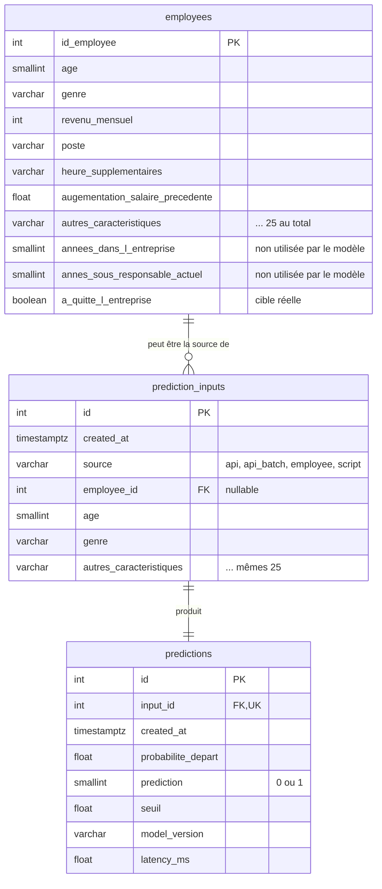

# Base de données PostgreSQL

## Rôle de la base

Toute interaction avec le modèle passe par la base :

1. les données envoyées au modèle sont enregistrées dans `prediction_inputs` ;
2. le modèle calcule la prédiction ;
3. le résultat est enregistré dans `predictions`, lié à son entrée ;
4. l'entrée et la sortie sont validées dans **une seule transaction** : pas de prédiction sans trace, pas de trace à moitié écrite.

Ce chemin unique (`app/services.py`, fonction `predire_et_tracer`) est utilisé par l'API (`/predict`, `/predict/batch`,
`/employees/{id}/predict`) et par le script `scripts/predict_from_db.py`.

Une requête refusée par la validation Pydantic (422) n'atteint jamais le modèle : rien n'est écrit en base.

## Schéma (UML / entité-association)



Le DDL complet est dans [`sql/01_schema.sql`](../sql/01_schema.sql) (généré à partir des modèles SQLAlchemy de
[`app/models.py`](../app/models.py), qui restent la seule source de vérité).

## Les tables

| Table | Contenu | Lignes |
|---|---|---|
| `employees` | Dataset RH du projet 4 : 25 caractéristiques utilisées par le modèle, 2 colonnes écartées au projet 4, la cible réelle | 1 470 |
| `prediction_inputs` | Chaque demande envoyée au modèle : les 25 caractéristiques, la date, l'origine et, si elle vient du dataset, l'employé concerné | 1 par prédiction |
| `predictions` | Chaque réponse du modèle : probabilité, décision, seuil appliqué, version du modèle, temps de calcul | 1 par entrée |

## Choix de conception

- **Entrées et sorties dans deux tables dédiées** (relation 1–1 avec `input_id` unique) : on sépare ce qui est envoyé
  au modèle de ce qu'il répond, comme demandé, et on peut retrouver pour chaque prédiction les données exactes qui l'ont produite.
- **Colonnes typées plutôt qu'un champ JSON** : les entrées sont requêtables directement en SQL
  (ex. taux de départ prédit par département) et contrôlées par des contraintes.
- **Mêmes noms de colonnes partout** (API, dataset, tables) : une ligne de `employees` peut être envoyée telle quelle au modèle.
- **`employee_id` facultatif** : une prédiction peut porter sur un employé du dataset (on peut alors comparer à la
  réalité) ou sur des données saisies librement via l'API.
- **`model_version` et `seuil` enregistrés à chaque prédiction** : si le modèle est réentraîné, l'historique reste interprétable.
- **Contraintes `CHECK`** (âge 18–70, satisfactions 1–4, probabilité 0–1, prédiction 0/1) : la base refuse une donnée
  incohérente même si elle ne passe pas par l'API.
- **Index** sur `created_at` (historique trié par date) et `employee_id` (prédictions d'un employé).
- **Volume** : environ 200 octets par prédiction ; un million de prédictions tiennent dans quelques centaines de Mo.
  L'historique est paginé côté API (`limit` ≤ 100).

## Sécurité et gestion des accès

Deux rôles PostgreSQL séparés (moindre privilège), créés par [`sql/00_roles.sql`](../sql/00_roles.sql) :

| Rôle | Utilisé par | Droits |
|---|---|---|
| `technova_admin` | `create_db.py`, `load_dataset.py` | Propriétaire de la base : crée les tables, charge le dataset |
| `technova_app` | API, `predict_from_db.py`, `query_db.py` | `SELECT` sur `employees` ; `SELECT, INSERT` sur `prediction_inputs` et `predictions` |

L'API ne peut donc **ni modifier ni supprimer** l'historique, ni toucher au dataset (vérifié : `UPDATE`, `DELETE`
et `DROP` renvoient `permission denied`). Les mots de passe sont dans `.env` (jamais commité) et, en CI, dans les secrets GitHub.

## Mise en place

```bash
# 1. Rôles et base (une seule fois, avec un compte superutilisateur PostgreSQL)
psql -d postgres -v admin_pwd="'MOT_DE_PASSE_ADMIN'" -v app_pwd="'MOT_DE_PASSE_APP'" -f sql/00_roles.sql

# 2. Renseigner DATABASE_URL et DATABASE_ADMIN_URL dans .env (voir .env.example)

# 3. Tables + droits du rôle applicatif
python scripts/create_db.py

# 4. Chargement du dataset (relançable sans doublon)
python scripts/load_dataset.py
```

## Interagir avec les données et le modèle

```bash
python scripts/predict_from_db.py --limit 50     # prédit sur 50 employés de la base (tracé en base)
python scripts/predict_from_db.py --ids 1 2 3
python scripts/query_db.py                       # volumes, dernières prédictions, prédiction vs réalité…
python scripts/query_db.py --export data/examples/predictions_exemples.csv
```

Exemple d'entrées / sorties enregistrées : [`data/examples/predictions_exemples.csv`](../data/examples/predictions_exemples.csv).

Depuis l'API : `GET /predictions` (historique paginé, filtrable par `prediction=1`), `GET /predictions/{id}`
(une prédiction et ses données d'entrée), `GET /employees/{id}`, `POST /employees/{id}/predict`.
